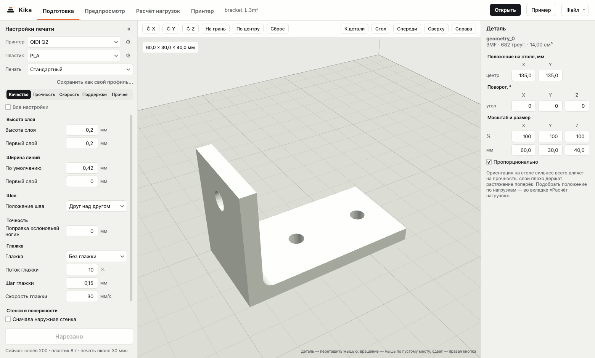
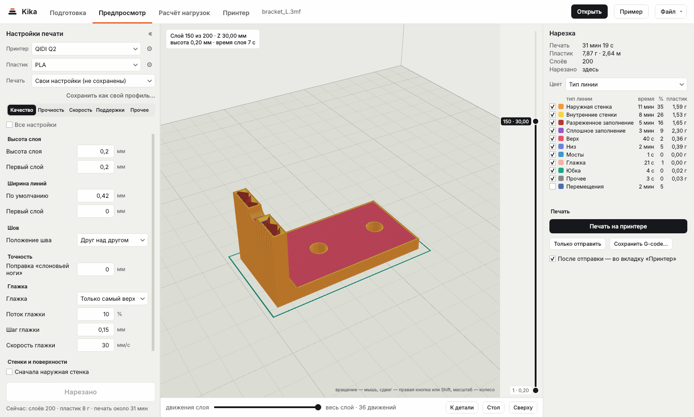
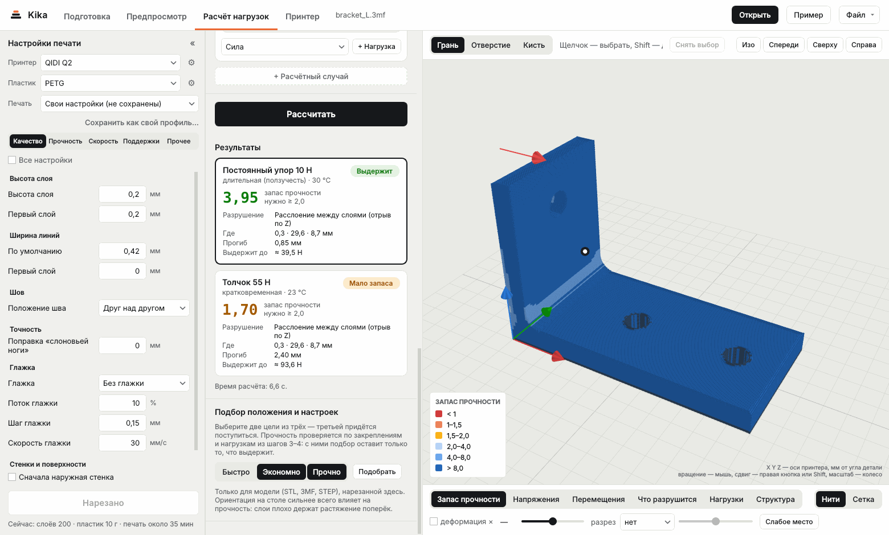
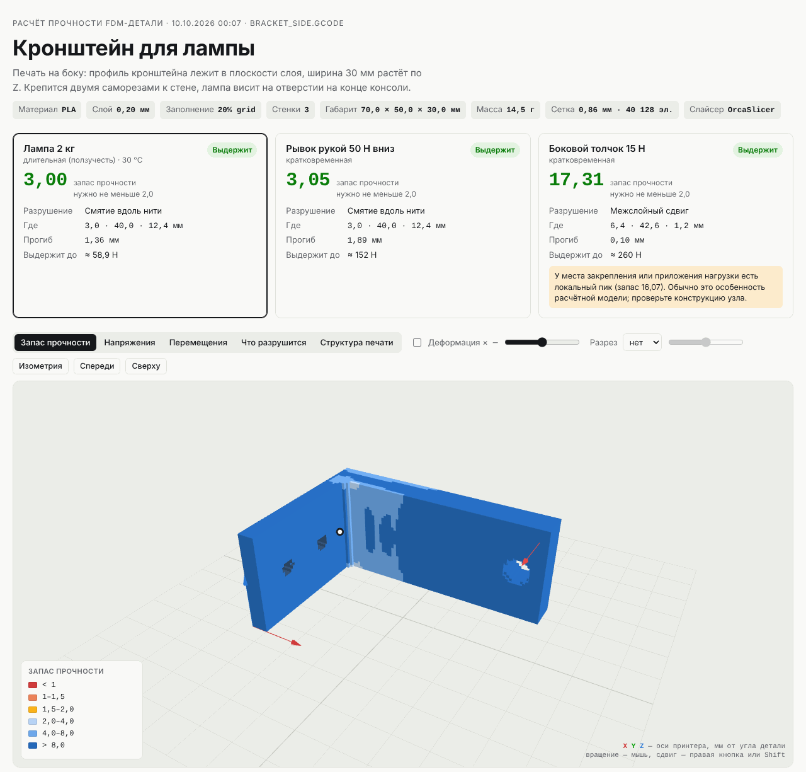

# Kika — расчёт прочности деталей для FDM-печати

Программа отвечает, выдержит ли напечатанная деталь нагрузку. Считает по реальным траекториям сопла из G-code и учитывает главное свойство печатных деталей: вдоль нити пластик прочнее, чем поперёк, а слабее всего — сцепление слоёв.

Ядро переносится с прототипа на Python (папка [`prototype/`](prototype/)) на C++. Каждый перенесённый модуль сверяется с прототипом на одних и тех же файлах. Планы, этапы и сроки — в проектном документе [«САПР для 3D-печати»](https://claude.ai/code/artifact/f01a13ed-8ef5-4a14-8678-5e1580c6a166).

## Что уже работает

| Модуль | Состояние |
| --- | --- |
| Разбор G-code: OrcaSlicer, Bambu Studio, PrusaSlicer, Cura, Simplify3D | перенесён; на всех примерах совпадает с прототипом, работает примерно в 10 раз быстрее |
| Материалы: база из 10 пластиков, анизотропия, критерий Хоффмана | перенесены, совпадают с прототипом |
| Воксельная модель: плотность, направления нитей, роли | перенесена, совпадает с прототипом |
| Метод конечных элементов и решатель | перенесены, совпадают с прототипом; считают на всех ядрах |
| Нагрузки, закрепления, запас прочности, команда `kika run` | перенесены; на кронштейнах, всех видах нагрузок и консольной балке совпадают с прототипом; примерно в 2,5 раза быстрее на 2 ядрах |
| Отчёт с 3D-видом: запас, напряжения, перемещения, вид разрушения, структура печати | перенесён; данные и текст совпадают с отчётом прототипа |
| Окно `kika-gui` на Qt: вкладки как в OrcaSlicer — «Подготовка» (деталь на столе), «Предпросмотр» (нарезка по слоям), «Расчёт нагрузок», «Принтер» (с веб-интерфейсом принтера); слева — настройки печати | готово; расчёт нагрузок повторяет приложение прототипа без браузера и Python |
| Подготовка: стол принтера в 3D, перетаскивание детали, поворот (в том числе «положить на грань»), масштаб и размер по осям | готово; закрепления и нагрузки при повороте и масштабе переносятся вместе с деталью |
| Предпросмотр нарезки: типы линий, скорость, расход, ширина, высота слоя, обдув, время слоя; диапазон слоёв, проход сопла по слою; время и пластик по типам линий | готово; читает и G-code OrcaSlicer, PrusaSlicer, Bambu Studio, Cura |
| Деталь в окне рисуется нитями — валиками по траекториям сопла из G-code, а не кубиками сетки | готово; сетка — по кнопке |
| Модели STL (двоичный и текстовый), 3MF (единицы, преобразования, сборки из компонентов) и STEP (через OpenCascade) | готово; STEP — в программе с окном |
| Свой слайсер: слои, стенки, сплошное и разреженное заполнение, юбка и кайма, шов, G-code для принтера | готово; консольная балка по своему G-code сходится с аналитикой так же, как по слайсеру тестов прототипа |
| Возможности слайсера как в OrcaSlicer: ширина линий по видам, толщина верха и низа, монотонный и концентрический верх, мосты по опорам, глажка, поправки отверстий, контура и «слоновьей ноги», замедление мелких периметров | готово; код Orca и Prusa не используется — только названия и устройство настроек |
| G-code для настоящего принтера: профиль QIDI Q2 (Klipper) и принтеров на Marlin, ускорения по видам линий, обдув и замедление коротких слоёв, предел расхода сопла, подъём сопла, время печати с разгонами, миниатюра | готово; G-code для Q2 проверен на настоящем Moonraker (время, пластик, высота, миниатюры видны) |
| Настройки нарезки: принтер, пластик, печать — 116 параметров по страницам, как в OrcaSlicer; свои профили | готово; в окне — панель слева, в задании — поле `print`, в командной строке — `--set` |
| Печать по сети: принтеры с Klipper и Moonraker (QIDI Q2, Voron, Creality K1 и другие) — поиск в сети, состояние, отправка и запуск, пауза, отмена | готово; проверено на имитации Moonraker и на настоящем Moonraker без Klipper; первая печать на Q2 — под присмотром |
| Рисунки заполнения: сетка, гироид, кубы, соты, 3D-соты, треугольники, тригексагон, линии, концентрическое | готово; доля пластика у всех рисунков совпадает с заданной плотностью до 1–2 % |
| Поддержки обычные и древовидные: нависания, зазоры до детали, плотные контактные слои, «только от стола» | готово; поддержки печатаются, в расчёт прочности не входят, в окне видны отдельным цветом |
| Подбор положения детали и настроек печати: две цели из трёх — быстро, экономно, прочно | первая версия: шесть положений, слой, стенки, заполнение, рисунок; запас прочности — расчётом по закреплениям и нагрузкам задания |

Порядок переноса и устройство ядра — в [docs/ARCHITECTURE.md](docs/ARCHITECTURE.md).

## Готовая программа без сборки

После каждого изменения GitHub собирает программу под Windows: вкладка **Actions** → последняя сборка с зелёной галочкой → внизу **Artifacts**:

- `kika-gui-windows-x64` — **программа с окном**. Распакуйте архив целиком в любую папку и запустите `kika-gui.exe`. Рядом лежат библиотеки Qt и среды выполнения — они нужны окну; устанавливать ничего не надо. Там же `kika.exe` для командной строки и папка `examples` с примером.
- `kika-windows-x64` — только `kika.exe` (один файл без библиотек) и `kika_tests.exe`. Эта сборка не открывает STEP: для него нужны библиотеки OpenCascade, они есть в папке программы с окном (там `kika.exe` STEP открывает).

**Проще всего — перетащить файл на `kika.exe`.** Файл G-code — откроется окно со сведениями о печати. Файл задания `.json` — программа посчитает прочность детали, сохранит рядом с заданием отчёт и откроет его в браузере. Окно закрывается по Enter. Можно перетащить сразу несколько файлов.

Готовый отчёт по примеру кронштейна лежит в той же сборке, в артефакте `kika-report-example`.

Если Windows покажет «Система Windows защитила ваш компьютер» — программа пока без цифровой подписи: «Подробнее» → «Выполнить в любом случае». Либо до запуска: правый щелчок по `kika.exe` → Свойства → «Разблокировать».

Из командной строки (в папке с `kika.exe` наберите `cmd` в адресной строке Проводника):

```
kika деталь.gcode                         что извлечено из G-code: слайсер, пластик, слои, объём
kika info деталь.gcode --json             то же в JSON
kika run деталь.gcode задание.json        расчёт прочности по заданию и отчёт с 3D-видом
kika run задание.json --open              G-code из задания, отчёт сразу открыть в браузере
kika materials                            встроенная база материалов
kika segments деталь.gcode -o отрезки.csv все отрезки экструзии в CSV
kika info модель.stl                      модель: габарит, объём, замкнута ли поверхность
kika slice модель.3mf --walls 3           нарезать своим слайсером → модель_kika.gcode
kika slice модель.stl --pattern gyroid --support tree   гироид, древовидные поддержки
kika slice модель.stl --set speed_outer_wall=120 --set filament.nozzle_temp=250   любая настройка
kika slice модель.3mf --send 192.168.1.50 --start       нарезать, отправить на принтер и печатать
kika printer                              найти принтеры с Moonraker в своей сети
kika printer 192.168.1.50                 состояние принтера; --pause, --resume, --cancel
kika send деталь.gcode --printer 192.168.1.50 --start  отправить готовый G-code и печатать
kika settings                             все настройки нарезки: ключи, пределы, значения
kika advise задание.json --goals economy,strength       подобрать положение и настройки печати
kika run задание.json                     задание по модели ("model" вместо "gcode"): нарезка и расчёт
```

## Окно

`kika-gui.exe` — слайсер и расчёт прочности в одном окне. Откройте модель (STL, 3MF, STEP) или готовый G-code кнопкой «Открыть» или перетащите файл в окно — или нажмите «Пример»: откроется кронштейн с готовым заданием. Вверху — четыре вкладки, как в OrcaSlicer; в первых трёх слева — **настройки печати**.

**Настройки печати** (панель слева): принтер, пластик и профиль печати, под ними — страницы «Качество», «Прочность», «Скорость», «Поддержки», «Прочее» с теми же названиями и разделами, что в OrcaSlicer: высота слоя, ширина линий, шов, поправки размеров, глажка, стенки, верх и низ (число слоёв, толщина, рисунок), заполнение, скорости и ускорения, мосты, поддержки, юбка и кайма. Флажок «Все настройки» показывает и тонкие (ширина каждой линии, ускорения отдельных линий…). ⚙ у принтера и пластика открывает их настройки: стол, пределы, откат, стартовый G-code; температуры, обдув, расход. Свои настройки сохраняются профилями и появляются в списках. «Нарезать» режет деталь заново с этими настройками; пока нарезка устарела, кнопка подсвечена. Панель сворачивается кнопкой ««».

1. **Подготовка** — стол принтера в 3D и деталь на нём. Деталь можно перетащить мышью, повернуть на 90° вокруг X, Y, Z, **положить на грань** (кнопка «На грань», затем щелчок по грани детали — она станет низом), поставить в центр, растянуть или сжать (масштаб в процентах или размер в миллиметрах по осям стола, пропорционально или по одной оси). Справа — положение, углы, масштаб и размер числами. Если деталь не помещается в область печати, она краснеет и появляется предупреждение.
2. **Предпросмотр** — нарезка по слоям, как в слайсере: цвет по типу линии (стенки, заполнение, верх, низ, мосты, глажка, юбка, поддержки…), по скорости, расходу, ширине линии, высоте слоя, обдуву или времени слоя. Ползунок справа — диапазон слоёв (верхняя и нижняя ручки), ползунок снизу — проход сопла по верхнему слою. Справа — время печати и пластик, по каждому типу линии — время, доля и граммы; флажками типы прячутся. Здесь же **«Печать на принтере»** и «Только отправить» (см. [Печать на принтере](#печать-на-принтере)) и «Сохранить G-code». Флажок «После отправки — во вкладку «Принтер»» включает и выключает автопереход. Открытый G-code другого слайсера (OrcaSlicer, PrusaSlicer, Bambu Studio, Cura) тоже показывается здесь.
3. **Расчёт нагрузок** — пошаговая панель, как в приложении прототипа:
   1. **Деталь** — сведения о печати и детальность сетки (точнее — дольше расчёт). Если настройки или положение детали изменены после нарезки, здесь появится предупреждение и «Нарезать заново»: выбранные закрепления и нагрузки останутся на своих местах, при повороте и масштабе переносятся вместе с деталью.
   2. **Материал** — пластик из базы (тот же, что в настройках печати) и нужный запас прочности; свойства можно заменить своими числами.
   3. **Закрепления** — щёлкните по поверхности, которой деталь крепится, и нажмите «Закрепить выбранное». Над 3D-видом три инструмента: «Грань» — плоская грань целиком, «Отверстие» — стенка отверстия, «Кисть» — всё в радиусе от точки. Shift — добавить к выбору, Ctrl или Alt — убрать, Esc — снять выбор.
   4. **Нагрузки** — выберите поверхность, вид нагрузки и нажмите «+ Нагрузка». Расчётных случаев может быть несколько, каждый считается отдельно.

   «Рассчитать» — расчёт идёт в фоне, окно не замирает. Справа — запас прочности, напряжения, перемещения (можно показать деформацию), что разрушится первым; разрез по любой оси и кнопка «Слабое место». Деталь рисуется **нитями** — валиками по траекториям сопла; кнопка «Сетка» показывает расчётную сетку из кубиков. Внизу панели — **подбор положения и настроек** (см. [Подбор положения и настроек печати](#подбор-положения-и-настроек-печати)).
4. **Принтер** — подключение, состояние, пауза и отмена печати, а справа — **веб-интерфейс принтера** (Fluidd или Mainsail: камера, консоль, файлы, настройки Klipper) прямо в окне.

Меню «Файл»: открыть и сохранить задание (формат `kika run` — его можно открыть в окне снова или посчитать из командной строки), сохранить G-code, сохранить отчёт (тот же HTML, что у `kika run`). Открываются и задания из примеров (поверхности заданы геометрически: сторона, отверстие, параллелепипед), и задания, сохранённые приложением прототипа. Задание по модели сохраняется с моделью, настройками печати и положением детали (`"model"`, `"print"`) — в окне и в `kika run` деталь нарежется так же.







Если окно не открывается или 3D-вид пустой (нет драйвера видеокарты, удалённый рабочий стол, виртуальная машина), запустите `kika-gui-software.cmd` из той же папки — он включает программный OpenGL.

## Печать на принтере

Kika отправляет G-code на принтеры с **Klipper и Moonraker** — так работают QIDI Q2, Voron, Creality K1 и многие другие; туда же отправляют файлы OrcaSlicer и другие слайсеры. Принтеры только на Marlin (без Moonraker) по сети не принимают — для них G-code сохраняется в файл («Сохранить G-code») и печатается с флешки.

**QIDI Q2** — принтер по умолчанию. Его профиль: стол 270 × 270 × 256 мм, сопло до 370 °C, стол до 120 °C, камера до 65 °C, скорость до 600 мм/с, ускорение до 20 000 мм/с². Стартовый код вызывает макрос прошивки `PRINT_START BED=… HOTEND=… CHAMBER=…`: принтер сам паркуется, выравнивает стол и снимает его карту (только под деталью — она размечена `EXCLUDE_OBJECT`), чистит сопло, греет стол, камеру и сопло. Потом Kika печатает полосу прочистки у переднего края (левый передний угол — там механизм реза и чистки — не трогает). Конец — `PRINT_END`. На экране принтера видны номер слоя, время, пластик и картинка детали.

**В окне** — вкладка «Принтер». Введите адрес принтера (он на экране принтера в настройках сети, например `192.168.1.50`) и нажмите «Подключить», или «Найти в сети» — Kika опросит свою сеть и найдёт принтеры с Moonraker сама. Компьютер и принтер должны быть в одной сети. Дальше видно состояние: что печатается, сколько готово, номер слоя, сколько осталось, температуры сопла, стола и камеры; «Пауза», «Продолжить», «Отменить печать». Справа открывается веб-интерфейс принтера (у QIDI Q2 — Fluidd); если он на другом адресе, впишите его в поле «Веб-интерфейс». «Отправить и печатать» (и «Печать на принтере» во вкладке «Предпросмотр») берёт текущую нарезку (или открытый G-code), показывает, что будет напечатано — пластик, температуры, время, — и после подтверждения отправляет файл и запускает печать; после отправки окно само переходит во вкладку «Принтер», если этот флажок включён в предпросмотре. «Только отправить» кладёт файл на принтер — запустить его можно с экрана принтера. Адрес запоминается, при открытии вкладки Kika подключается сама.

Встроенный веб-интерфейс — это Qt WebEngine (браузер Chromium в составе Qt, LGPL-3.0). Он есть в готовой программе для Windows; если программа собрана без него, вкладка показывает адрес и кнопку «Открыть в браузере».

**Из командной строки:**

```
kika printer                                   найти принтеры в сети
kika printer 192.168.1.50                      состояние и температуры
kika slice уголок.3mf --send 192.168.1.50 --start
kika send уголок.gcode --printer 192.168.1.50 --start
kika printer 192.168.1.50 --pause | --resume | --cancel
```

Без `--start` файл только отправляется. Если принтер занят или Klipper не готов, файл отправляется без запуска. Имя файла на принтере — латиницей (экраны принтеров часто не показывают кириллицу): «Уголок» станет `Ugolok.gcode`. Если Moonraker требует ключ, он задаётся `--key` (в окне — поле «Ключ API»); в домашней сети он обычно не нужен. Адрес по умолчанию можно задать переменной окружения `KIKA_PRINTER`.

**Перед первой печатью** стойте рядом: Kika пока проверена на имитации Moonraker и на настоящем Moonraker без принтера, а не на живом Q2. Убедитесь, что стол чист, пруток заправлен, и посмотрите, как принтер выполнит `PRINT_START` и полосу прочистки.

## Подбор положения и настроек печати

Деталь можно напечатать быстро, экономно или прочно — но сразу все три не получится: прочнее — значит больше стенок и пластика, быстрее — толще слой и меньше заполнения. Kika подбирает положение детали на столе и настройки печати под **две цели из трёх**:

- **быстро и экономно** — самый дешёвый по времени и пластику вариант, который ещё выдерживает нагрузки с нужным запасом;
- **быстро и прочно** — наибольший запас прочности на минуту печати;
- **экономно и прочно** — наибольший запас прочности на грамм пластика.

Прочность — всегда условие: если в задании есть закрепления и нагрузки, варианты с запасом меньше нужного не рекомендуются. Без нагрузок подбор сравнивает только время и пластик и предупреждает, что прочность не проверялась.

Как подбирается. Сначала деталь кладётся на стол каждой из шести сторон («какой гранью вниз»); каждое положение режется своим слайсером — время печати и пластик берутся из нарезки, вместе с поддержками, если без них деталь не напечатать, — и считается на грубой сетке. Так учитывается главное свойство печатных деталей — слои слабее всего на отрыв: уголок из примеров стоя разрушается расслоением стенки (запас 1,69 при нужных 2), а положенный на бок профилем на стол держит ту же нагрузку с запасом 2,30 — и печатается быстрее, 25 минут вместо 35: стоя слои стенки маленькие, и их приходится замедлять, чтобы успели остыть. На лучшем положении перебираются слой, число стенок, заполнение и, когда важна прочность, рисунок заполнения. В конце запас лучших вариантов (и «как сейчас» — для сравнения) уточняется на подробной сетке: грубая ошибается на 5–10 %, а то и больше.

**В окне** — во вкладке «Расчёт нагрузок», внизу панели: две кнопки целей из трёх («Быстро», «Экономно», «Прочно»; третья нажатая отжимает ту, что нажата раньше) и «Подобрать». Подбор идёт в фоне, обычно минуту-две. Итог — объяснение (что выбрано, сколько запаса, времени и пластика против «как сейчас») и три лучших варианта с кнопкой «Применить»: она ставит это положение и настройки и режет деталь заново, закрепления и нагрузки поворачиваются вместе с деталью. Запас уточняется на сетке той же детальности, что выбрана в окне (не больше 120 тыс. элементов), — после «Применить» и «Рассчитать» получится то же число.

**Из командной строки** — для задания по модели (`"model"` и `"print"`):

```
> kika advise examples\bracket_L.job.json --goals economy,strength --save-job уголок_подбор.json
Цель — экономно и прочно. Лучше всего: поворот X -90°; слой 0,20 · 3 стенки · 20 % сетка.
Ожидается: запас 2,30 (нужно 2,0), печать ≈ 25 мин, пластик 10 г.
Сейчас: запас 1,69 (нужно 2,0), печать ≈ 35 мин, пластик 10 г. …

Варианты (лучшие первыми):
1. поворот X -90°; слой 0,20 · 3 стенки · 20 % сетка
   запас 2,30 · печать 25 мин · 10 г
2. поворот X -90°; слой 0,20 · 4 стенки · 25 % гироид
   запас 2,54 · печать 28 мин · 12 г
…
> kika run уголок_подбор.json
```

Цели: `speed`, `economy`, `strength` (или по-русски: `скорость`, `экономия`, `прочность`) — ровно две через запятую. `--save-job` пишет задание с лучшим вариантом (`--variant 2` — со вторым): закрепления и нагрузки в нём уже перенесены на деталь в новом положении, `kika run` посчитает его с тем же запасом, что в «Ожидается». `--json варианты.json` — все варианты в JSON, `--max-elems` — сетка для сравнения (по умолчанию 20 000), `--refine-elems` — сетка уточнения (по умолчанию — из задания, не больше 120 000).

Это первая версия. Положения — только «гранью вниз» (повороты на 90°), без наклонов; подбор не меняет пластик, ширину линии и температуры; время печати — по скоростям, ускорениям и замедлению коротких слоёв из настроек, без нагрева и подготовки принтера.

## Расчёт прочности

Что посчитать, описывает файл задания: материал, закрепления и нагрузки. Готовые примеры — `prototype/examples/bracket_side.job.json` и `bracket_upright.job.json` (кронштейн лампы, напечатанный на боку и стоя) и [`examples/bracket_L.job.json`](examples/) — уголок из модели 3MF, который нарезает свой слайсер. Формат со всеми видами нагрузок и способами выбрать поверхность — в [docs/JOB_FORMAT.md](docs/JOB_FORMAT.md).

```
> kika run prototype\examples\bracket_side.job.json
G-code: C:\project_kika\prototype\examples\bracket_side.gcode
  слайсер OrcaSlicer, пластик PLA, слой 0.2 мм, заполнение 20% grid, габарит [69.96, 49.96, 30.0] мм
  сетка: воксель 0.568 мм, 117119 элементов, 130916 узлов
…
Материал: PLA   требуемый запас: 2

▶ Лампа 2 кг  [длительная (ползучесть)]
   Итог: ВЫДЕРЖИТ   запас прочности 2.55  (в точке [3.7, 40.59, 13.5] мм)
   Вид разрушения: Смятие вдоль нити
   Наибольшее перемещение: 1.413 мм
   Предельная сила на отверстие ≈ 50,1 Н
```

Кроме текста в окне, `kika run` сохраняет **отчёт** — один HTML-файл рядом с заданием (`bracket_side_отчёт.html`). Он открывается в любом браузере без установки и без интернета: карточки расчётных случаев и 3D-модель, которую можно вращать, раскрашенная по запасу прочности, напряжениям, перемещениям, виду разрушения или структуре печати (стенки, сплошное и разреженное заполнение); есть разрез и показ деформации. Отчёт можно переслать: всё нужное внутри.



Параметры: `-o отчёт.html` — куда записать отчёт, `--open` — открыть его в браузере, `--no-report` — без отчёта, `--voxel 0.5` — размер вокселя в мм, `--max-elems 150000` — предел числа элементов (меньше — быстрее и грубее), `--threads 4` — число потоков (по умолчанию все ядра), `--json итоги.json` — итоги в JSON, `--quiet` — без строк хода расчёта.

## Сборка на Windows

Нужны Git и Visual Studio Community с набором «Разработка классических приложений на C++». В нём уже есть компилятор, CMake, Ninja и vcpkg. Библиотеки при первой настройке скачиваются сами, это занимает несколько минут.

**В Visual Studio.** Файл → Открыть → Папка → папка проекта. Студия найдёт `CMakePresets.json`. В списке конфигураций вверху выберите «Windows x64 — Release», затем Сборка → Собрать все. Тесты — Тест → Обозреватель тестов.

**В командной строке.** Откройте «Developer PowerShell for VS» (обычный PowerShell не подойдёт: в нём нет компилятора и vcpkg):

```
git clone https://github.com/Demid-dclxvi/project_kika
cd project_kika
cmake --preset win-release
cmake --build --preset win-release
ctest --preset win-release
build\win-release\bin\kika.exe info prototype\examples\bracket_side.gcode
```

Если `cmake` пишет, что не найден `vcpkg.cmake`, значит не задана переменная `VCPKG_ROOT`. Поставьте vcpkg отдельно:

```
git clone https://github.com/microsoft/vcpkg C:\vcpkg
C:\vcpkg\bootstrap-vcpkg.bat
setx VCPKG_ROOT C:\vcpkg
```

и откройте новое окно Developer PowerShell.

**Окно (kika-gui).** Нужен Qt 6.8 для MSVC — бесплатная версия под LGPL. Проще всего поставить его через aqtinstall (без учётной записи Qt):

```
python -m pip install aqtinstall
python -m aqt install-qt windows desktop 6.8.3 win64_msvc2022_64 -m qtwebengine qtwebchannel qtpositioning -O C:\Qt
setx QT_ROOT_DIR C:\Qt\6.8.3\msvc2022_64
```

(или установщиком Qt: Qt 6.8 → «MSVC 2022 64-bit» и в Additional Libraries — «Qt WebEngine», «Qt WebChannel», «Qt Positioning»). Модули WebEngine нужны только для веб-интерфейса принтера во вкладке «Принтер»: без них окно соберётся, а страница принтера будет открываться в браузере (сборку без них можно задать и явно: `-DKIKA_WITH_WEBENGINE=OFF`). Откройте новое окно Developer PowerShell или перезапустите Visual Studio и выберите конфигурацию «Windows x64 с окном (Qt) — Release»:

```
cmake --preset win-gui-release
cmake --build --preset win-gui-release
C:\Qt\6.8.3\msvc2022_64\bin\windeployqt build\win-gui-release\bin\kika-gui.exe
build\win-gui-release\bin\kika-gui.exe
```

Первая настройка этой конфигурации долгая: vcpkg собирает OpenCascade для чтения STEP (это может занять час), дальше берёт его из своего кэша. `windeployqt` кладёт библиотеки Qt рядом с программой (с WebEngine — ещё `QtWebEngineProcess.exe` и его ресурсы, около 200 МБ) — без них окно не запустится (или добавьте `C:\Qt\6.8.3\msvc2022_64\bin` в PATH). Окно собирается отдельной конфигурацией: Qt подключается библиотеками DLL, поэтому и среда выполнения C++ там в DLL, а `kika.exe` из обычной конфигурации — один файл без библиотек. Тесты — в обычной конфигурации.

## Сверка с прототипом

```
python -m pip install numpy scipy
python tools/compare_with_prototype.py --kika build\win-release\bin\kika.exe
```

Скрипт разбирает примеры прототипа и синтетические случаи обеими версиями и сравнивает каждый отрезок, затем считает задания кронштейнов, все виды нагрузок и консольную балку и сравнивает итоги, воксели и поля напряжений. В CI это делается автоматически на Linux. `--skip-analysis` — только разбор G-code (тогда scipy не нужен).

## Структура

```
src/core/      ядро — библиотека без интерфейса (kika_core)
src/report/    HTML-отчёт с 3D-видом (kika_report); web/ — просмотрщик и three.js
src/geometry/  модели: треугольная сетка, STL, 3MF (ZIP и XML свои), STEP через OpenCascade (kika_geometry)
src/slicer/    свой слайсер: модель → слои → заполнение, поддержки → G-code (kika_slicer, Clipper2)
src/advisor/   подбор положения детали и настроек печати по двум целям из трёх (kika_advisor)
src/printer/   принтер по сети: свой HTTP-клиент на сокетах и Moonraker (kika_printer)
src/app/       логика окна без Qt: сцена, нити, выбор граней, задание из окна, предпросмотр G-code (kika_app)
apps/cli/      консольная программа kika
apps/gui/      окно kika-gui на Qt: вкладки, панель настроек печати, стол и предпросмотр, расчёт, принтер
packaging/     файлы для папки с программой (Windows)
tests/         тесты (Catch2); tests/data — G-code для тестов
examples/      примеры моделей и заданий (примеры по G-code — в prototype/examples)
docs/          устройство ядра, формат задания
tools/         вспомогательные скрипты; mock_moonraker.py — имитация принтера для проверки отправки
prototype/     прототип на Python — эталон для сверки, не изменяется
```

## Лицензии

Код проекта принадлежит автору. Сторонние библиотеки и их лицензии — в [THIRD_PARTY.md](THIRD_PARTY.md). Библиотеки под AGPL в продукт не входят.
